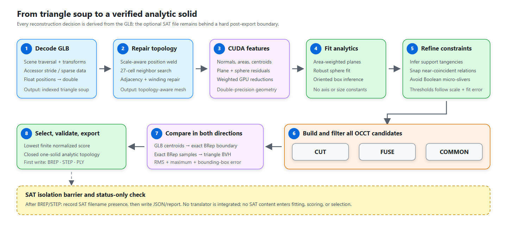
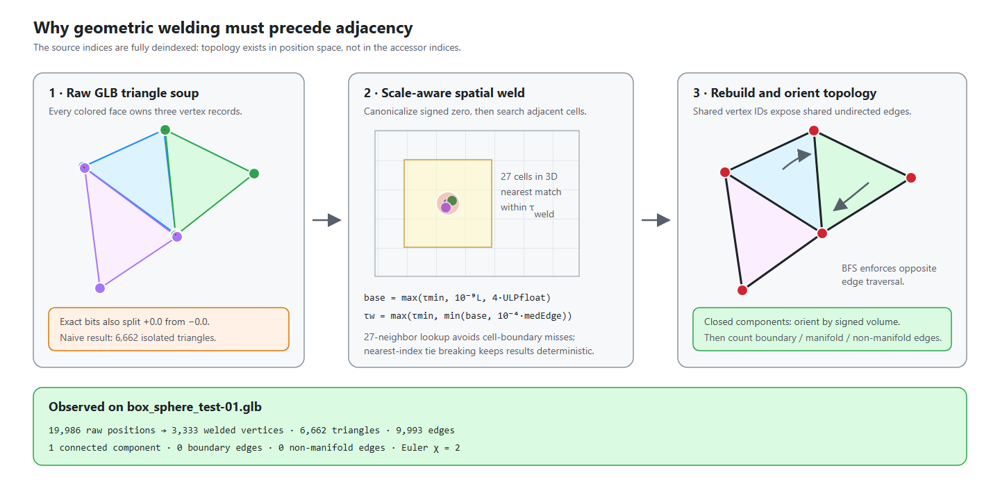
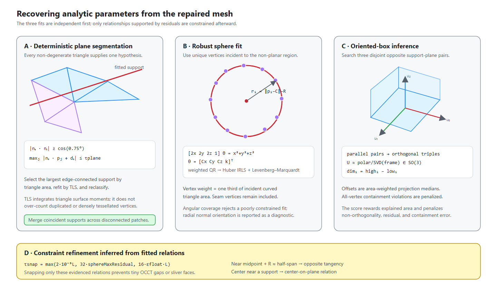
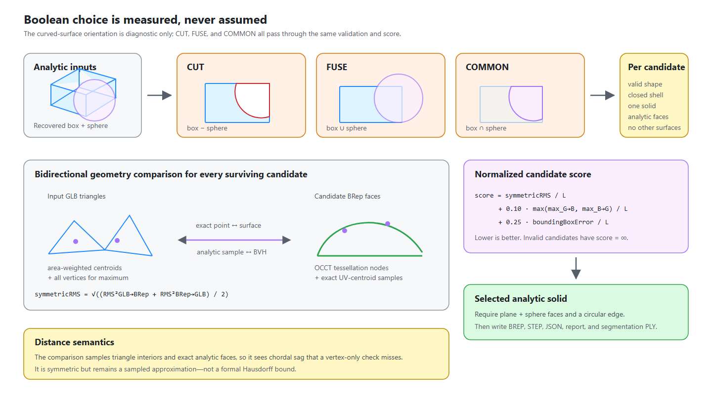

# reCAD mesh2brep proof of concept

`mesh2brep` reconstructs a watertight analytic OpenCascade solid from a tessellated
GLB. The production path is native C++20/CUDA: it expands the glTF scene, repairs
position-based topology, calculates triangle geometry on the GPU, recovers planes,
a sphere, and an oriented box, builds `CUT`, `FUSE`, and `COMMON`, and selects the
candidate that best matches the input surface in both directions.

The reconstruction is GLB-only. It does not assume the model is axis-aligned, does
not hardcode its dimensions or Boolean operation, and does not read the supplied
SAT to obtain a reference answer.

This proof of concept is intentionally scoped to a GLB surface representable by one
oriented box and one sphere combined with `CUT`, `FUSE`, or `COMMON`. It does not
yet discover arbitrary primitive families, repeated analytic primitive instances,
or general CSG trees.



Vector source: [`pipeline.svg`](docs/pipeline.svg)

## Reconstruction contract

The implementation follows four rules:

1. **Infer, then regularize.** Primitive parameters are fit independently from the
   GLB. Exact tangency or coincidence is imposed only when fitted residuals and
   model scale support that relationship.
2. **Use geometric rather than accessor topology.** The supplied GLB is fully
   deindexed triangle soup. Adjacency is constructed only after position welding.
3. **Let OCCT create exact boundaries.** Mesh seam polylines are never promoted to
   CAD edges. The Boolean between analytic primitives creates exact planes, a
   sphere, circles, and trimmed faces.
4. **Measure every Boolean hypothesis.** Curved-facet orientation is useful as a
   diagnostic, but it never chooses `CUT`, `FUSE`, or `COMMON`. Selection uses the
   same unsigned geometric score for all three candidates.

The SAT file is behind a hard isolation barrier. Only its filename presence is
checked, and only after the selected BREP and STEP have been written. No SAT
translator is integrated in this executable, so the build reports verification as
unsupported instead of parsing or approximating SAT geometry.

## Notation and tolerance policy

All fitting is performed in transformed GLB coordinates using `double`. Let:

- `L` be the input axis-aligned bounding-box diagonal;
- `A_t` be a triangle's area;
- `eps_f` and `eps_d` be the float and double machine epsilon;
- `ULP_f,max` be the largest single-precision ULP at any transformed source
  coordinate;
- `tau_w` be the weld tolerance.

The CLI uses these production tolerances:

| Quantity | Definition | Value for the supplied GLB |
|---|---|---:|
| Model scale | `L = norm(bounds.max - bounds.min)` | `173.2050808` |
| Weld base | `b = max(1e-12, 1e-9 L, 4 ULP_f,max)` | `3.0517578e-5` |
| Weld tolerance | `tau_w = max(1e-12, min(b, 1e-4 medianEdge))` | `3.0517578e-5` |
| Plane distance | `tau_plane = max(1e-6 L, 8 tau_w)` | `2.4414063e-4` |
| Minimum plane area | `5e-4 * total mesh area` | `33.92457` |
| Box support distance | `max(2e-6 L, 8 tau_w, 4 maxPlaneResidual)` | `3.4641016e-4` |
| Analytic relation snap | `max(2e-5 L, 32 rawSphereMax, 16 eps_f L)` | `3.4641016e-3` |
| Post-snap sphere inlier | `max(1e-5 L, 8 rawSphereMax)` | `1.7320508e-3` |
| OCCT fuzzy value | `max(1e-8 L, 4 tau_w)` | `1.2207031e-4` |
| BRep comparison deflection | `2e-4 L` | `3.4641016e-2` |

Fitting and scoring do not clamp `L` to one model unit; divisions use the smallest
positive `double` as a guard. Preprocessing still has deliberate numerical floors:
the weld is at least `1e-12`, the median-edge estimator ignores edges below
`max(L,1) * eps_d * 64`, and sphere normalization has an epsilon-based floor.

## Algorithm

### 1. Decode and expand the GLB scene

[`MeshLoader.cpp`](src/MeshLoader.cpp) loads the binary GLB into memory with
TinyGLTF, but performs the scene expansion itself so all geometry reaches fitting
in one world coordinate system.

1. Select the requested scene, otherwise the glTF default scene, otherwise scene
   zero. If the file has no scenes, traverse every root node.
2. Recursively accumulate node transforms as `world = parent * local`. A node's
   explicit 4x4 matrix takes precedence over TRS. TRS is composed as `T * R * S`,
   with a normalized quaternion and glTF's column-major convention.
3. Decode dense, interleaved, and sparse accessors with their buffer-view offset,
   accessor offset, stride, component type, and normalized-integer conversion.
   `POSITION` must be finite `VEC3` data. Missing index accessors become a sequential
   `0..N-1` sequence.
4. Expand `TRIANGLES`, `TRIANGLE_STRIP`, and `TRIANGLE_FAN` primitives into explicit
   triples. Unsupported primitive modes do not produce faces. Skinning and morph
   deformation are not applied; the loader API appends warnings for these cases.
5. Transform positions to world-space `double`. If the accumulated linear transform
   has negative determinant, exchange the second and third triangle indices to
   preserve orientation under the mirrored transform.

Imported corner normals are deliberately not used for topology or fitting. They
can be smooth across a curved face or duplicated across a crease; geometric normals
are recomputed from transformed positions.

Bounds and welding scale are calculated from all expanded positions. This includes
unreferenced positions, if a source primitive contains them, so malformed or mixed
content can still affect model scale. Unreferenced positions are not separately
diagnosed by the current CLI.

### 2. Position welding, cleanup, and topology repair



Vector source: [`welding-topology.svg`](docs/welding-topology.svg)

Welding uses positions only, never `(position, normal)` pairs. Before hashing,
`-0.0` is canonicalized to `+0.0`; otherwise numerically equal seam vertices can
occupy different exact-bit keys.

For each source position, the loader:

1. Computes integer spatial-hash coordinates with cell width `tau_w`.
2. Searches the containing cell and all 26 neighbors.
3. Chooses the closest existing representative within `tau_w`; an equal-distance
   tie chooses the smaller representative index.
4. Keeps the representative coordinate instead of averaging positions.

The 27-cell search matters because two points within tolerance can fall on opposite
sides of a cell boundary. The method is deterministic for fixed input order,
though—as with most incremental welders—the representative choice is order-dependent
and the relation is not transitively closed.

After reindexing, a face is discarded when it repeats a vertex or when its twice
area satisfies:

```text
norm((p1 - p0) x (p2 - p0)) <= L^2 * eps_d * 64
```

Topology is then rebuilt from undirected edge keys:

- one incident triangle is a boundary edge;
- two are a manifold edge;
- more than two are a non-manifold edge;
- all triangles sharing an edge become neighbors;
- connected components and `chi = V_used - E + F` are computed.

For winding repair, each shared edge creates an XOR constraint: neighboring faces
must traverse it in opposite directions. A breadth-first traversal propagates the
required flips. Non-manifold incidences or contradictory constraints append warnings
to `MeshLoadResult`; the current CLI does not serialize that warning list. For each
closed component, the translated signed six-volume

```text
6V = sum dot(a - r, (b - r) x (c - r))
```

chooses the global outward orientation; `r` is the mean of that component's used
vertices. Open components retain an arbitrary global sign. Input watertightness is
reported but is not a prerequisite for attempting reconstruction; the final CAD
solid is validated strictly.

### 3. CUDA triangle features and residual validation

[`CudaGeometry.cu`](src/CudaGeometry.cu) is part of the reconstruction path, not a
timing-only demonstration. The GPU result replaces the mesh's CPU triangle-feature
array before segmentation.

A grid-stride CUDA kernel assigns each triangle to one thread iteration and computes
its features in double precision:

```text
e1       = p1 - p0
e2       = p2 - p0
cross    = e1 x e2
A        = 0.5 * norm(cross)
n        = cross / norm(cross)
centroid = (p0 + p1 + p2) / 3
d        = -dot(n, centroid)
maxEdge  = max(norm(p1-p0), norm(p2-p1), norm(p0-p2))
```

The launch uses 256 threads per block and asynchronous transfers on a non-blocking
stream. CUDA events separately record host-to-device, kernel, device-to-host, and
total GPU time. Every allocation, launch, event, transfer, and synchronization is
checked for errors.

The same module evaluates fitted models over point batches:

```text
plane residual:  r_i = abs(n . p_i + d) / norm(n)
sphere residual: r_i = abs(norm(p_i - C) - R)
```

It returns every residual, an inlier byte mask, unweighted and weighted RMS,
maximum residual, inlier count, and inlier weight. Each block reduces 256 local
accumulators in shared memory before one atomic update per statistic. Floating-point
atomic ordering can change the final few bits, while classification and fitted
geometry remain stable.

Plane hypothesis enumeration and nonlinear fitting run on the CPU using the
CUDA-computed features. CUDA is used again after fitting to validate every final
plane and the post-constraint sphere. Their residual and inlier statistics are
recorded; the production tolerance formulas are documented in the table above.

### 4. Deterministic plane segmentation and TLS fitting



Vector source: [`analytic-recovery.svg`](docs/analytic-recovery.svg)

The executable uses a `0.75 degree` normal tolerance, `tau_plane` from the table,
at least two triangles, at least `5e-4` of total mesh area, and at most eight
refinement iterations.

For every non-degenerate triangle still unassigned, its geometric plane is used as
a deterministic hypothesis. Another triangle `t` is eligible only when both tests
pass:

```text
abs(dot(n_seed, n_t)) >= cos(0.75 degrees)
max over j in triangle(t) abs(dot(n_seed, p_j) + d_seed) <= tau_plane
```

The eligible set can contain disconnected pieces, so adjacency is used to retain
its largest edge-connected component. Competing hypotheses are ranked by summed
triangle area, with triangle count only breaking an area tie. Area weighting is
essential here: the sphere has 97.93% of the input triangles, while a large box
side can contain only three.

The selected component is refit by area-integrated total least squares. For one
triangle with `s = p0 + p1 + p2`, the exact uniform surface moments are:

```text
E[p]     = s / 3
E[p p^T] = (s s^T + p0 p0^T + p1 p1^T + p2 p2^T) / 12
```

These moments are accumulated with triangle-area weights. If `mu` is the resulting
centroid and `C = E[p p^T] - mu mu^T`, the eigenvector of `C` with the smallest
eigenvalue is the plane normal. Its sign follows the area-weighted facet normal,
and `d = -dot(n, mu)`. The fitted RMS is `sqrt(n^T C n)`; the maximum checks every
support-triangle vertex.

The implementation reclassifies against the TLS plane and refits until the support
stabilizes or eight iterations are reached. A proposed fit over `1.25 tau_plane`
is rejected. Accepted support triangles are peeled away and the search repeats.

Connectivity alone cannot define a CAD support plane. After region extraction,
disconnected segments are merged when their normals agree and their aligned offsets
are within:

```text
2 tau_plane + maxResidual_i + maxResidual_j
```

Each transitive merge is refit and kept only if its combined maximum residual is at
most `2 tau_plane`. This is why the supplied model yields six planes even though
the top support consists of four disconnected coplanar patches around a tangent
circular opening.

### 5. Robust sphere recovery

All unique welded vertices incident to non-planar triangles enter the sphere fit.
A vertex shared by a plane and the curved region remains included. Its weight is:

```text
w_i = sum over incident curved triangles (A_t / 3)
```

Coordinates are normalized as `q_i = (p_i - weightedMean) / L`, and weights are
normalized to sum to one. This improves conditioning without changing the fitted
world-space model.

The initial sphere solves the weighted algebraic system by column-pivoted QR:

```text
[2qx  2qy  2qz  1] [Cx Cy Cz k]^T = qx^2 + qy^2 + qz^2
R^2 = dot(C, C) + k
```

The matrix must have rank four and `R^2` must be positive. The seed is refined by
Huber-weighted Levenberg-Marquardt on the signed radial residual:

```text
e_i(C, R) = norm(q_i - C) - R
```

When no threshold is supplied, the normalized Huber scale is:

```text
delta = max(1.345 * 1.4826 * median(abs(initial e_i)), 128 eps_d)
```

Each iteration forms the robust weighted normal equations, applies diagonal LM
damping, and accepts only a step that lowers Huber cost. Damping is multiplied by
ten on rejection and quartered on acceptance. Refinement stops after 64 iterations,
after no acceptable step, or when the normalized step is below `1e-12` relative to
the current center and radius.

The fit is rejected when the smallest eigenvalue of the weighted radial-direction
moment matrix is below `1e-5`, which catches inadequate angular coverage. The
area-weighted agreement between facet normals and sphere radial directions is
reported as outward, inward, or ambiguous. It is diagnostic only and has no role
in Boolean selection.

### 6. Oriented-box recovery from plane pairs

No global X/Y/Z assumption is made. [`Geometry.cpp`](src/Geometry.cpp) first creates
every pair of spatially separated planes whose normals are parallel within one
degree. Alignment uses `abs(dot(n_i,n_j))`, so same-facing and opposite-facing
stored normals are both valid.

It then enumerates triples of pairs subject to two structural tests:

- all six plane-segment indices are distinct;
- the three pair axes are mutually orthogonal within two degrees.

Axes receive a deterministic order by dominant world component. The approximate
3x3 direction matrix is orthonormalized with SVD as `U V^T`; if the result is
improper, its third column is flipped to produce a right-handed frame.

For each side, every support-triangle vertex is projected onto its candidate axis
with weight `A_t / 3`. The area-weighted projection median gives `low_i` or `high_i`.
Containment violation is measured over every input vertex and penalized. The
hypothesis score is maximized:

```text
boxScore = supportedArea / totalMeshArea
         - 10 * orthogonalityError
         -  2 * sumParallelAngleError
         - 10 * supportRMS / L
         - 20 * containmentViolation / L
```

The winning parameters are:

```text
dimension_i = high_i - low_i
center      = sum_i axis_i * (low_i + high_i) / 2
```

Equal dimensions can make axis permutation or sign non-unique, but all such frames
describe the same box. `reconstruction.json` includes the full recovered axes,
low/high coordinates, dimensions, center, corners, and supporting planes.

### 7. Data-derived analytic constraint refinement

Independent floating-point fits can miss an intended tangency by a few microns.
Passing those raw values directly to OCCT can create tiny gaps or sliver faces.
[`main.cpp`](src/main.cpp) therefore examines each recovered box axis using
`tau_snap`, without inserting a known dimension or expected topology.

For axis `u`, let `lo`, `hi`, `mid = (lo + hi)/2`, and `half = (hi - lo)/2`.

- If `dot(C,u)` is near `mid` and `R` is near `half`, the sphere center coordinate
  is snapped to `mid` and `half` becomes a radius observation. This represents
  tangency to both opposing supports.
- If the center coordinate is near `lo` or `hi`, it is snapped onto that support.
- All accepted half-span radius observations are averaged.

The post-snap sphere is then reevaluated by CUDA. JSON preserves the raw and refined
parameters and lists every inferred relationship; the text report prints the refined
sphere and its residual summary. For the supplied GLB, the constraints discover
tangency to the two pairs of side supports and a center on the recovered top support.

### 8. Construct and filter OCCT Boolean candidates

[`CadReconstruction.cpp`](src/CadReconstruction.cpp) lightly re-orthogonalizes the
recovered box frame, computes its minimum corner, and creates:

```text
box    = BRepPrimAPI_MakeBox(gp_Ax2(corner, zAxis, xAxis), dx, dy, dz)
sphere = BRepPrimAPI_MakeSphere(center, radius)
```

OCCT then builds `box - sphere`, `box union sphere`, and `box intersect sphere` with
non-destructive and parallel Boolean processing plus the scale-aware fuzzy value
from the tolerance table. Exceptions or failed builders invalidate only that
candidate.

Before a candidate can receive a finite score, it must:

- be non-null and pass `BRepCheck_Analyzer`;
- have every shell closed;
- contain exactly one solid;
- contain no face type other than plane or sphere.

This pre-score gate does not require both surface types; that stronger structural
check is applied to the selected result. It prevents an invalid candidate from
winning through a numerical penalty while allowing a legitimate analytic result to
be compared first.

### 9. Bidirectional comparison and Boolean selection



Vector source: [`boolean-scoring.svg`](docs/boolean-scoring.svg)

An unsigned one-way distance can reward a solid that contains the observed surface
plus substantial extra geometry. Every surviving candidate is therefore compared
in both directions by [`Distance.cpp`](src/Distance.cpp).

**GLB to BRep.** OCCT distance queries target a compound containing only candidate
faces. This avoids the zero containment distance that a point inside a solid would
otherwise receive. Each non-degenerate input triangle contributes one exact
point-to-boundary query at its centroid, weighted by `A_t`. Every welded vertex is
also queried, but only to extend the maximum statistic; it does not enter RMS or
mean.

**BRep to GLB.** OCCT tessellates every candidate face with linear deflection
`2e-4 L` and angular deflection `0.08` radians. The input triangles are indexed in a
median-split AABB tree: the widest centroid extent is split until a leaf contains at
most eight triangles, and leaf queries use exact point-to-triangle distance. Each
BRep tessellation triangle contributes its three nodes. When UV nodes are present,
the averaged UV is also evaluated on the exact `BRepAdaptor_Surface`, so the fourth
sample lies on the analytic face rather than its chord. Area is divided equally
among the four samples, or among three nodes when UV is unavailable.

For weighted residuals `r_i`:

```text
RMS = sqrt(sum(w_i r_i^2) / sum(w_i))

symmetricRMS = sqrt((RMS_GLB_to_BRep^2 + RMS_BRep_to_GLB^2) / 2)

bboxError = norm(candidateMin - meshMin) + norm(candidateMax - meshMax)

score = symmetricRMS / L
      + 0.10 * max(max_GLB_to_BRep, max_BRep_to_GLB) / L
      + 0.25 * bboxError / L
```

The lowest finite score wins. Candidate order is `CUT`, `FUSE`, `COMMON`, so an
exact score tie retains `CUT`; the supplied data is not close to a tie. These are
sampled, unsigned boundary distances—not a mathematically exhaustive Hausdorff
bound and not an inside/outside classification.

### 10. Final structural validation and export

After score selection, the winner must still be a valid, closed, one-solid shape
with at least one planar face, at least one spherical face, no other surface type,
and at least one circular edge. A failure aborts export rather than silently
falling back to a different Boolean hypothesis.

Shape inspection also records unique solid, face, edge, and vertex counts; line,
circle, and other curve counts; exact OCCT volume and area; and the BRep bounds.
Only after these checks does the program write:

- `reconstructed.brep` — native OpenCascade BRep;
- `reconstructed.step` — STEP `AsIs`, explicitly declaring millimetres;
- `reconstruction.json` — machine-readable parameters, scores, residuals, topology,
  timings, environment, and isolated SAT presence/status result;
- `report.txt` — a concise human-readable run summary (JSON remains the full record);
- `segmentation.ply` — welded input vertices and per-triangle plane labels.

BREP, STEP, and PLY are written before the isolated SAT filename-presence check.
JSON and the text report are written afterward so they can include the resulting
`UNSUPPORTED` or `NOT_FOUND` status. No SAT file content is opened in either case.

The GLB has no authoritative CAD unit metadata. Numeric coordinates are preserved,
and the assumed STEP output unit is stated explicitly instead of inferred from
geometry size.

## Verified result for the supplied GLB

The values below come from a clean x64 Release reconstruction, not from SAT.

| Mesh property | Result |
|---|---:|
| Raw `POSITION` entries | `19,986` |
| Welded vertices | `3,333` |
| Triangles / unique edges | `6,662 / 9,993` |
| Connected components | `1` |
| Boundary / non-manifold edges | `0 / 0` |
| Degenerate triangles | `0` |
| Bounds | `(-50,-50,0) .. (50,50,100)` |
| Watertight | `yes` |

The original accessor indices are sequential `0..19985`, so naive index adjacency
would produce 6,662 isolated triangles and 19,986 apparent boundary edges. The weld
also canonicalizes signed zero; an exact-bit position map would leave false seams at
tangent vertices.

| Recovered analytic model | Result |
|---|---|
| Planes | `6` supports; `138` planar triangles total |
| Curved region | `6,524` triangles, `3,325` unique fitting points |
| Raw sphere | `C=(2.82e-10,-6.38e-12,99.99999887)`, `R=49.99999973` |
| Refined sphere | `C=(0,0,100)`, `R=50` |
| Sphere residual | RMS `1.19e-6`, max `3.08e-6`, `3325/3325` CUDA inliers |
| Box | center `(0,0,50)`, dimensions `(100,100,100)` |
| Box support residual | RMS/max `0 / 0` |

The top `z=100` support is geometrically one plane but topologically four disconnected
patches of 31 triangles, because the circular opening is tangent to all four side
boundaries. The coplanar-merge stage deliberately preserves that distinction in its
`connected_components` report while returning one analytic support plane.

| Boolean | Score | GLB to BRep RMS / max | BRep to GLB RMS / max |
|---|---:|---:|---:|
| `CUT` | `7.613e-5` | `0.01122 / 0.02810` | `0.00884 / 0.03083` |
| `FUSE` | `0.18633` | `8.62720 / 50.00000` | `15.75877 / 70.69933` |
| `COMMON` | `0.23622` | `29.01640 / 72.47449` | `7.36056 / 33.92966` |

`CUT` is selected by score. The final shape is a valid closed solid with 10 faces
(9 planar and 1 spherical), 22 edges, 13 vertices, no unsupported surface types,
volume `738200.6122`, and area `67853.9816`.

The approximately `0.03` maximum surface deviation is expected chordal sag
between the analytic sphere and curved GLB triangles. Sphere *vertices* fit at about
`1e-6`, which is why vertex-only validation would be misleadingly optimistic.

## Source map

| File | Responsibility |
|---|---|
| [`include/Geometry.h`](include/Geometry.h) | Mesh, topology, plane, sphere, and oriented-box data model |
| [`src/MeshLoader.cpp`](src/MeshLoader.cpp) | GLB decode, scene transforms, primitive expansion, welding, winding repair |
| [`src/CudaGeometry.cu`](src/CudaGeometry.cu) | Triangle features, model residuals, weighted reductions, timings |
| [`src/Geometry.cpp`](src/Geometry.cpp) | Topology rebuild, plane TLS/segmentation, sphere LM, oriented-box search |
| [`src/CadReconstruction.cpp`](src/CadReconstruction.cpp) | OCCT primitives, Booleans, shape inspection, candidate filtering, export |
| [`src/Distance.cpp`](src/Distance.cpp) | Exact boundary queries, triangle BVH, reverse sampling, scores |
| [`src/main.cpp`](src/main.cpp) | Production tolerances, constraint refinement, orchestration, reports |

## Verified local toolchain

- Windows 11 x64
- Visual Studio Community 2026 18.9, MSVC 19.51.36256 (`v145`)
- Visual Studio bundled CMake 4.3.1
- CUDA Toolkit 13.2.51
- NVIDIA GeForce RTX 5060, compute capability 12.0
- OpenCascade 8.0.0 (local vcpkg build)

## Build in Visual Studio 2026

From PowerShell in the repository root:

```powershell
.\scripts\bootstrap-dependencies.ps1
.\scripts\build-vs2026.ps1 -Configuration Both -SkipDependencies
```

The bootstrap script installs OpenCascade, Eigen, nlohmann-json, and stb with vcpkg
and downloads the pinned TinyGLTF 3.0.0 header directly. The build script then
configures CMake and generates `build\vs2026\reCAD_mesh2brep.slnx` with x64 Debug
and Release configurations. Open that solution in Visual Studio 2026; CMake
configures the debugger working directory and default arguments for `mesh2brep`.

The checked-in target is compiled for CUDA architecture `120` (compute capability
12.0). An NVIDIA GPU with a different compute capability requires changing
`CUDA_ARCHITECTURES` in `CMakeLists.txt` to a supported architecture and rebuilding.

The equivalent explicit configure command is:

```powershell
& 'C:\Program Files\Microsoft Visual Studio\18\Community\Common7\IDE\CommonExtensions\Microsoft\CMake\CMake\bin\cmake.exe' `
  --preset vs2026
```

## Run

```powershell
.\build\vs2026\bin\Release\mesh2brep.exe `
  --input .\testData\box_sphere_test-01.glb `
  --output .\output
```

The report distinguishes raw GLB positions from welded topology, records CUDA
device and kernel timings, lists every fitted plane and residual, prints all three
Boolean scores, checks analytic face and edge types, and reports both distance
directions.

## Test

After the Release build:

```powershell
& 'C:\Program Files\Microsoft Visual Studio\18\Community\Common7\IDE\CommonExtensions\Microsoft\CMake\CMake\bin\ctest.exe' `
  --preset release
```

The integration test reconstructs the GLB from scratch and requires a valid,
closed analytic solid with planar and spherical faces plus a scale-aware symmetric
distance threshold. It does not assert a known Boolean operation or use SAT-derived
parameters.

Visual Studio 2026 uses its current `.slnx` solution format here. The generated
`mesh2brep.vcxproj` explicitly uses platform toolset `v145`, CUDA 13.2 build
customizations, and x64 Debug/Release configurations.
